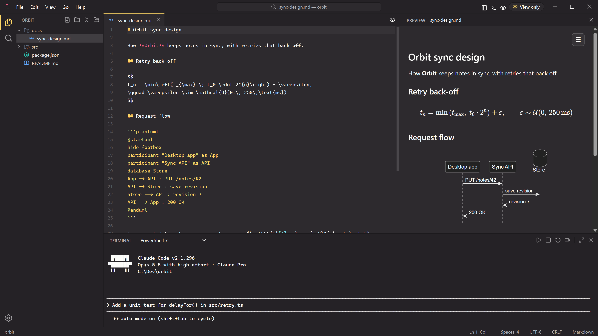
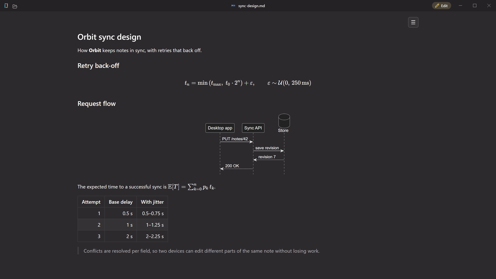
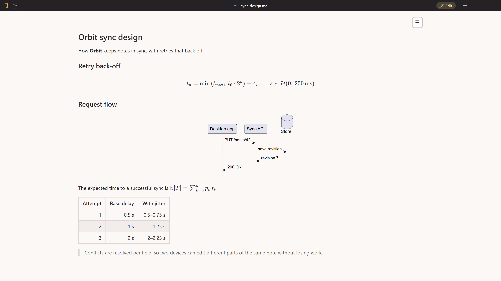
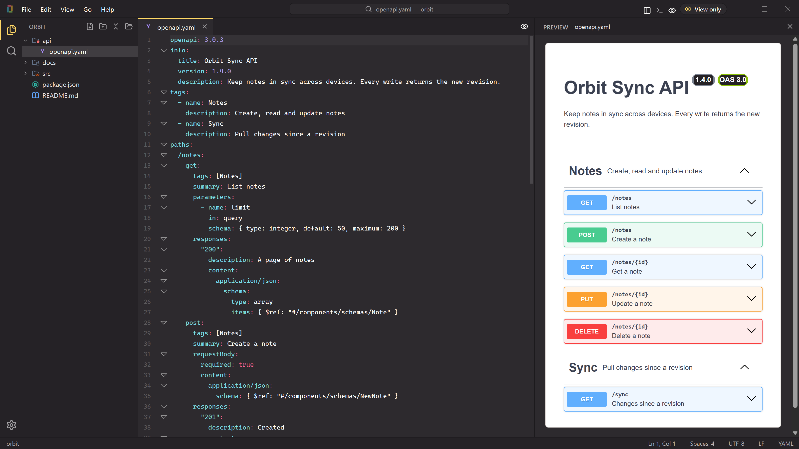
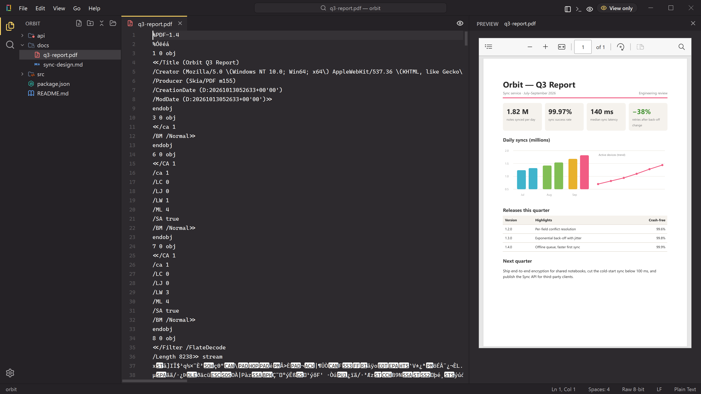

<h1 align="center">MDLite</h1>

A lightweight, native text and code editor for Windows with a built-in <b>Preview</b> and <b>Terminal</b>. 
A modern take on the classic Notepad++ workflow, without Electron. Free for everyone.

<a href="https://apps.microsoft.com/detail/9NGXBT327D13"><b>Get it from the Microsoft Store</b></a> · <a href="https://github.com/Duclevn/MDLite/releases/latest"><b>Download from GitHub</b></a> · <a href="https://github.com/Duclevn/MDLite/issues">Report an issue</a>

MDLite starts fast and stays small: Preview and Terminal are loaded only when you open them, so the editor on its own uses about 15 MiB of memory in a typical window.

## Download

- **Microsoft Store (recommended):** [apps.microsoft.com/detail/9NGXBT327D13](https://apps.microsoft.com/detail/9NGXBT327D13). The Store version is signed by Microsoft and updates itself.
- **Installer:** from [Releases](https://github.com/Duclevn/MDLite/releases/latest), run `MDLite-<version>-windows-x64-setup.exe`. It installs for your user only, needs no administrator rights and updates an older install in place.
- **Portable:** unzip `MDLite-<version>-windows-x64.zip` anywhere and run `MDLite.exe`. The portable copy registers nothing on your system.

Requirements: Windows 10 (1809 or later) or Windows 11, x64. Preview and Terminal use the Microsoft Edge **WebView2 Runtime**, which comes preinstalled on Windows 11.

**"Windows protected your PC"?** The GitHub downloads are not code-signed, so Microsoft Defender SmartScreen does not recognise the publisher and asks you to confirm. Check the SHA-256 checksum listed in the release notes, then choose **More info → Run anyway**. The Microsoft Store version installs without this warning.

## Features

- **Editor:** fast Scintilla editing, syntax highlighting, brace matching, highlight of the selected word, word wrap, zoom, multi-cursor and a split editor. Saves keep your encoding and line endings (UTF-8/16/32 with BOM detection), never write half a file, and notice when another program changed the file.
- **Hot exit:** closing MDLite keeps unsaved edits and open tabs for the next start. You can turn it off in Settings.
- **Preview:** Markdown (tables, code highlighting, Mermaid, PlantUML, KaTeX math), JSON tree view, OpenAPI/Swagger, CSV, PDF and images. Everything renders offline, with network access blocked.
- **View only mode** (`Ctrl+Alt+V`, or the **View only** / **Edit** button in the title bar): the window shows just the file, as its Preview or as read-only text, with nothing else around it. The mode is remembered, so a file you double-click opens straight into the quiet reading view.
- **Terminal:** integrated PowerShell, Command Prompt or WSL, with copy and paste as in Windows Terminal. MDLite asks before closing over a running command.
- **Workspace:** folder Explorer with file-type icons, drag and drop, delete to the Recycle Bin, and Go to File (`Ctrl+P`) with fuzzy search.
- **Command Palette** (`Ctrl+Shift+P`): every command, Go to Line, Go to Symbol, color theme, language and indentation pickers.
- **Find and Replace:** find as you type, match count, regular expressions, case and whole-word options.
- **Themes:** Default (Mariana-style), Dark and Light, with a compact custom title bar that keeps Windows Snap Layouts.

| | |
|---|---|
|  |  |
|  |  |

## Open with

The installer and the Store version add MDLite to File Explorer's **Open with** menu for these file types. Your default apps do not change; to always open a type in MDLite, choose **Open with → Choose another app → MDLite → Always**.

| Type | Extensions |
|---|---|
| Markdown | `.md` `.markdown` `.mdown` `.mkd` `.mdx` |
| Text | `.txt` `.log` |
| JSON | `.json` `.jsonc` `.json5` `.geojson` `.webmanifest` |
| YAML | `.yaml` `.yml` |
| Configuration | `.toml` `.ini` `.cfg` `.conf` `.properties` `.editorconfig` `.gitignore` `.gitattributes` `.env` |
| CSV | `.csv` `.tsv` |
| XML, HTML, SVG | `.xml` `.xsd` `.xsl` `.xslt` `.html` `.htm` `.svg` |
| Diagrams | `.mmd` `.mermaid` `.puml` `.plantuml` |
| C/C++ | `.c` `.h` `.cc` `.cpp` `.cxx` `.hh` `.hpp` `.hxx` `.inl` `.ipp` `.cu` |
| Python | `.py` `.pyw` `.pyi` |
| JavaScript, TypeScript | `.js` `.mjs` `.cjs` `.jsx` `.ts` `.tsx` `.mts` `.cts` |
| Style sheets | `.css` `.scss` `.less` |
| Scripts | `.sh` `.bash` `.zsh` `.ps1` `.psm1` `.psd1` |
| Other source code | `.cs` `.java` `.kt` `.kts` `.scala` `.groovy` `.gradle` `.go` `.rs` `.swift` `.dart` `.rb` `.php` `.lua` `.sql` |

Files opened while MDLite is running, or several selected at once, open as tabs in the window that is already open. `MDLite.exe --new-window <file>` opens a separate window.

## Keyboard shortcuts

| Action | Shortcut |
|---|---|
| Command Palette | `Ctrl+Shift+P` / `F1` |
| Go to File (type `name:12` to open at a line) | `Ctrl+P` |
| Go to Line | `Ctrl+G` |
| Go to Symbol in the file (or type `@` in Go to File) | `Ctrl+Shift+O` |
| Find / Replace | `Ctrl+F` / `Ctrl+H` |
| Toggle Explorer / Terminal / Preview | `Ctrl+B` / `Ctrl+Shift+T` (or ``Ctrl+` ``) / `Ctrl+Shift+V` |
| Split editor | `Ctrl+\` |
| View only / Edit mode | `Ctrl+Alt+V` |
| Word Wrap | `Alt+Z` |
| Zoom in / out / reset | `Ctrl+=` / `Ctrl+-` / `Ctrl+0` |
| Next / previous editor | `Ctrl+Tab` / `Ctrl+Shift+Tab` |
| Go back / forward | `Alt+Left` / `Alt+Right`, or the mouse back / forward buttons |
| Settings | `Ctrl+,` |

Editing keys follow VS Code and Sublime Text:

| Editing | Shortcut |
|---|---|
| Add next occurrence / select all occurrences | `Ctrl+D` / `Ctrl+Shift+L` |
| Add cursor above / below | `Ctrl+Alt+Up` / `Ctrl+Alt+Down` |
| Column (box) selection | `Ctrl+Shift+Alt+Arrows`, or `Alt`+drag |
| Move line up / down | `Alt+Up` / `Alt+Down` |
| Copy line up / down | `Shift+Alt+Up` / `Shift+Alt+Down` |
| Delete line | `Ctrl+Shift+K` |
| Toggle line comment | `Ctrl+/` |
| Uppercase / lowercase | `Ctrl+K Ctrl+U` / `Ctrl+K Ctrl+L` |

To change a shortcut, run **File › Keyboard Shortcuts (JSON)**. It opens `keybindings.json` in the VS Code format and lists every command with its default keys; saving the file applies your changes.

## Privacy

MDLite collects no data: no telemetry, no accounts, no update check. See [PRIVACY.md](PRIVACY.md).

## Source code and license

MDLite is free software under the GNU General Public License, version 3 or later ([LICENSE](LICENSE)). The complete source code of every version is attached to its release as `MDLite-<version>-source.zip`, next to the QScintilla source it is built with. The *Source code* links that GitHub adds to each release contain only the files of this page.

The name **MDLite** and its logo are not covered by the license: see [TRADEMARKS.md](TRADEMARKS.md). If you publish a modified version, please give it a different name and icon.

Copyright (C) 2026 Duclevn.
